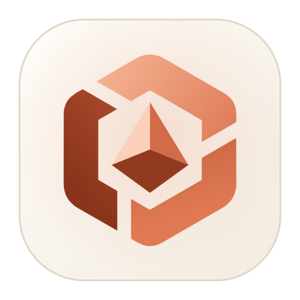

<p align="center">
  
</p>

<h1 align="center">Atrium</h1>

<p align="center">
  <strong>Official Open-Source Desktop Client — A Calm, Warm Studio AI Agent Workbench</strong>
</p>

<p align="center">
  <strong>English</strong> ·
  <a href="README.zh-CN.md">简体中文</a> ·
  <a href="https://github.com/yasmeendawnelle-spec/Atrium/releases">Releases (Download)</a> ·
  <a href="#local-development">Local Development</a> ·
  <a href="LICENSE">MIT License</a>
</p>

<p align="center">
  <a href="https://github.com/yasmeendawnelle-spec/Atrium/releases/latest">
    
  </a>
  <a href="LICENSE">
    
  </a>
</p>

---

## Download & Install (Releases)

Looking for ready-to-run desktop installers for **Windows**, **macOS**, or **Linux** without building from source?

- **Latest Version**: **[Download Latest Release (GitHub Releases)](https://github.com/yasmeendawnelle-spec/Atrium/releases/latest)**
- **All Versions**: **[Browse All Releases](https://github.com/yasmeendawnelle-spec/Atrium/releases)**
  - **Windows (`x64`)**: Download `Atrium-Setup-<version>.exe`. (Unsigned build: if SmartScreen shows *"Windows protected your PC"*, click **More info -> Run anyway**.)
  - **macOS (`Apple Silicon arm64` / `Intel x64`)**: Download `Atrium-<version>-mac-arm64.dmg` or `Atrium-<version>-mac-x64.dmg` (or `.zip`). Drag `Atrium.app` to Applications; since builds are ad-hoc signed without Apple notarization, run `xattr -cr /Applications/Atrium.app` (or right-click **Open**) on first launch.
  - **Linux (`x64`)**: Download `Atrium-<version>-linux-x64.AppImage` (make executable with `chmod +x` and run) or `Atrium-<version>-linux-amd64.deb` (`sudo apt install ./Atrium-*.deb`). For optional OS desktop automation tools on X11, install `xdotool`.
  - Built-in Windows auto-updater is included (`v0.2.0` and above can check for and install newer updates inside the app).

> **Account & BYOK Note**: Because this is the official Atrium client, signing in with an Atrium account (via Google, GitHub, or email registration/password) is required before opening the main workbench. Once signed in, you can use built-in Atrium Cloud models or add your own custom API keys (BYOK) and local Ollama endpoints anytime.

---

## Key Capabilities

- **Multi-Protocol LLM Engine & 2-Level Collapsible Model Picker**
  - Supports **Anthropic Messages**, **OpenAI Responses (Codex)**, and **Chat Completions** alongside custom third-party providers (BYOK) and local Ollama.
  - Organizes models into a clean **Provider (Level 1) -> Model Family (Level 2)** collapsible hierarchy across chat, settings, and provider forms.
  - Configurable context window limits (`Auto`, `64k`, `128k`, `200k`, `256k`, `400k`, `1M`) with dynamic auto-compaction scaled to 80% of the active context budget.

- **Built-in Browser & Dedicated Atrium Virtual Cursor (Computer Use)**
  - Prioritizes an isolated, per-conversation Chromium panel driven by Atrium's virtual cursor overlay and `sendInputEvent` so agent actions never hijack your physical OS mouse—while keeping an explicit opt-in toggle for full OS desktop control.
  - Supports switching between Edge (Bing) and Google search modes.

- **Visual MCP Marketplace, GitHub Inspector, Plugins & Skills**
  - Browse the official MCP registry or inspect any GitHub repository (read-only over API) before installing servers or plugin bundles.
  - Manage local Plugins, Skills, and optional lifecycle hooks (`PreToolUse`, `PostToolUse`, `Stop`).

- **Interactive Artifacts & Real PTY Terminal**
  - Offline sandboxed preview for React/JSX/TSX, HTML, Mermaid diagrams, Recharts visualizations, SVG, and structured Git diff review.
  - Integrated resizable PTY terminal drawer (`@xterm/xterm`) and Git worktree session isolation.

- **Knowledge Base, Long-Term Memory, Automations & Spotlight Quick Entry**
  - Local BM25 search across Markdown, code, PDF, DOCX, and XLSX documents plus cross-session memory extraction and management.
  - Cron and interval-based background automations.
  - Minimalist global floating bar (`Alt+Space`) with one-click screen capture, clipboard image paste, voice dictation, and instant handoff to the main workbench.

---

<a id="local-development"></a>

## Local Development

### Prerequisites

- **Node.js** >= 22 (uses `--experimental-strip-types` to run TypeScript tests directly)
- **npm** >= 10
- **OS**: Windows, macOS, or Linux

### Commands

```bash
# 1. Install dependencies
npm install

# 2. Start Electron + Vite dev server
npm run dev

# 3. Run TypeScript checks (Node & Web)
npm run typecheck

# 4. Run full unit test suite
npm test

# 5. Build production bundle (out/)
npm run build

# 6. Package Desktop installers per OS
npm run dist:installer   # Windows NSIS (.exe)
npm run dist:mac         # macOS (.dmg / .zip for arm64 + x64)
npm run dist:linux       # Linux (.AppImage / .deb for x64)
```

---

## Cross-Platform CLI (`Windows / macOS / Linux`)

Atrium also ships a standalone terminal CLI (`src/cli/`) that launches directly as **`atrium`** from any directory — reusing the full agent engine, AES-256-GCM secret storage, MCP tools, skills, and checkpoints across Windows, macOS, and headless Linux SSH environments:

### Global Install & Direct Launch

```powershell
# Windows (PowerShell) — installs atrium.exe into %USERPROFILE%\.local\bin and updates PATH
irm https://raw.githubusercontent.com/yasmeendawnelle-spec/Atrium/main/scripts/install.ps1 | iex
```

```bash
# macOS / Linux — installs atrium into ~/.local/bin and updates shell PATH
curl -fsSL https://raw.githubusercontent.com/yasmeendawnelle-spec/Atrium/main/scripts/install.sh | sh

# Or build & install the native SEA binary directly from a local clone
npm run cli:install
```

Once installed, type **`atrium`** in any terminal:

```bash
atrium                                 # Interactive chat (includes first-run setup wizard)
atrium doctor                          # Inspect runtime, provider, Git, and MCP health
atrium login                           # Sign in with Atrium Account (Email / Google / GitHub)
git diff | atrium -p "Review changes"  # One-shot piped prompt execution (--json / -y supported)
```

### Development & Packaging Commands

```bash
npm run cli -- --help                  # Run CLI directly from TypeScript source
npm run build:cli                      # Build dist-cli/atrium.cjs & sync packages/cli/bin/
npm run build:cli:bin                  # Compile standalone native SEA binary for current OS
npm run cli:uninstall                  # Remove local ~/.local/bin/atrium binary
```

---

## Project Structure

```text
atrium/
├── src/
│   ├── main/        # Electron main process, browser manager, quick entry, desktop driver, auto-updater
│   ├── core/        # Isolated core engine (agent loop, providers/, tools/, mcp/, knowledge, plugins, PTY)
│   ├── cli/         # Headless cross-platform CLI (REPL, encrypted secrets, OAuth/email login, doctor, one-shot/NDJSON)
│   ├── preload/     # Context-isolated preload bridge
│   ├── renderer/    # React + Vite frontend views, components, locales & design tokens
│   └── shared/      # Shared TypeScript types, presets, IPC contracts & cloud helpers
├── packages/
│   └── cli/         # Standalone zero-dependency @atrium-ai/cli package definition (bin: atrium)
├── test/            # Node native unit test suite
├── scripts/         # Artifact runtime, CLI CJS/SEA builders, install.sh / install.ps1 & release scripts
├── deploy/          # Generic Cloudflare Worker update server setup
├── docs/            # Design system notes
└── build/           # Application icons & brand SVG assets
```

---

## License

This project is open-sourced under the [MIT License](LICENSE).
