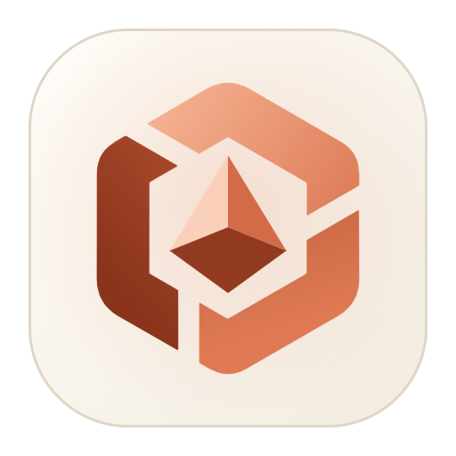

<p align="center">
  
</p>

<h1 align="center">Atrium</h1>

<p align="center">
  <strong>Atrium 官方开源桌面客户端 · 温暖工作室风格的本地与云端 AI Agent 工作台</strong>
</p>

<p align="center">
  <a href="README.md">English</a> ·
  <strong>简体中文</strong> ·
  <a href="https://github.com/yasmeendawnelle-spec/Atrium/releases">Releases 下载</a> ·
  <a href="#本地开发与构建">本地开发</a> ·
  <a href="LICENSE">MIT License</a>
</p>

<p align="center">
  <a href="https://github.com/yasmeendawnelle-spec/Atrium/releases/latest">
    
  </a>
  <a href="LICENSE">
    
  </a>
</p>

---

## 下载与安装（Releases）

如果不想从源码构建，可以直接下载对应系统的桌面安装包（支持 **Windows / macOS / Linux**）：

- **下载最新版本**：👉 **[前往 Releases 最新版本页](https://github.com/yasmeendawnelle-spec/Atrium/releases/latest)**
- **查看全部历史版本**：**[All Releases](https://github.com/yasmeendawnelle-spec/Atrium/releases)**
  - **Windows（`x64`）**：下载 `Atrium-Setup-<版本号>.exe` 安装运行（暂未购买商业签名证书，`signExecutable: false`，若 SmartScreen 拦截请点击 **「更多信息 → 仍要运行」**）。
  - **macOS（`Apple Silicon arm64` / `Intel x64`）**：下载 `Atrium-<版本号>-mac-arm64.dmg` 或 `Atrium-<版本号>-mac-x64.dmg`（亦提供 `.zip`），拖入应用程序后因暂未公证，如遇提示请执行 `xattr -cr /Applications/Atrium.app` 或右键「打开」。
  - **Linux（`x64`）**：下载 `Atrium-<版本号>-linux-x64.AppImage`（赋予 `chmod +x` 权限后运行）或 `Atrium-<版本号>-linux-amd64.deb`（`sudo apt install ./Atrium-*.deb`）。在 X11 下如需启用全桌面键鼠操控，可选安装 `xdotool`。
  - Windows 版从 `v0.2.0` 起内置自动更新检测，可在应用内检查并自动升级到最新版。

> **关于账号与模型接入说明**：本仓库为 Atrium 官方客户端源码。使用桌面端前需先在应用内登录 **Atrium 官方账号**（支持 Google / GitHub 授权或受支持的邮箱注册与密码登录）；登录后既可直接使用云端聚合模型与订阅额度，也可随时添加自有 API Key（BYOK）或本地 Ollama 服务。

---

## 核心特性

- **多协议模型引擎与两级折叠模型列表**
  - 原生兼容 **Anthropic Messages**、**OpenAI Responses（Codex）** 与 **Chat Completions** 三大协议，支持 Atrium Cloud、自定义第三方 API（BYOK）及本地 Ollama。
  - **两级可折叠模型树**：外层按用户配置的「模型供应商（大类）」默认折叠，展开后按模型系列自动划分「模型分类（小类）」收纳，避免长模型列表刷屏。
  - 支持在对话与设置中手动覆盖上下文窗口上限（Auto / 64k / 128k / 200k / 256k / 400k / 1M），并按有效上限的 80% 动态触发自动上下文压缩。

- **对话内嵌 Chromium 浏览器与独立虚拟光标（Computer Use）**
  - 每个对话拥有隔离的内置 Chromium 浏览器会话与专属 **Atrium 独立虚拟光标**，Agent 可直接在内置浏览器中点击、输入、滚动和抓取控制台与可交互元素引用，**不会抢占或移动用户自己的物理鼠标**；同时保留一键切换直接操控系统桌面的显式开关。
  - 支持 Edge（国内直连 Bing）与 Google 双浏览器模式切换。

- **可视化 MCP 市场、GitHub 导入与 Plugin / Skill 生态**
  - 内置官方 MCP 注册表搜索，支持贴入任意 GitHub 仓库链接并只读解析清单与 README，安装前清晰预览所需命令与环境变量。
  - 支持导入与管理 **Plugins**、**Skills** 与生命周期钩子（`PreToolUse` / `PostToolUse` / `Stop`）。

- **交互式 Artifacts 与内置 PTY 终端**
  - 离线沙箱实时渲染 React（JSX/TSX）、HTML、Mermaid 图表、Recharts 数据图、SVG 及结构化代码 Diff 审阅。
  - 集成可拖拽调整大小的真实 PTY 终端抽屉（`xterm.js`），与 Git 工作区 Diff、Worktree 分支隔离协作深度结合。

- **项目知识库、跨会话长期记忆、自动化与极简快捷悬浮窗**
  - 基于 BM25 的项目文档检索（支持 PDF、Word、Excel、Markdown 等多格式索引与拖拽入库）与跨会话长期记忆自动提炼管理。
  - 支持 Cron / 固定间隔本地定时自动化任务。
  - **全局快捷悬浮窗（Spotlight Bar）**：通过全局快捷键（默认 `Alt+Space`）随时呼出单栏极简悬浮条，支持一键截屏、剪贴板贴图、语音听写提问与一键切回主工作台。

---

<a id="本地开发与构建"></a>

## 本地开发与构建

### 环境要求

- **Node.js** >= 22（测试命令通过 `--experimental-strip-types` 直接运行 TypeScript）
- **npm** >= 10
- **操作系统**：Windows / macOS / Linux 全平台支持

### 常用命令

```bash
# 1. 安装依赖
npm install

# 2. 启动 Electron + Vite 开发模式
npm run dev

# 3. 运行 Node / Web 双端 TypeScript 类型检查
npm run typecheck

# 4. 运行全部单元测试
npm test

# 5. 构建生产产物 (out/)
npm run build

# 6. 按平台打包桌面安装器
npm run dist:installer   # Windows NSIS 安装包 (.exe)
npm run dist:mac         # macOS 安装包 (.dmg / .zip，含 arm64 + x64)
npm run dist:linux       # Linux 安装包 (.AppImage / .deb)
```

---

## 跨平台命令行 CLI（`Windows / macOS / Linux`）

Atrium 提供可全局安装并直接运行的独立终端 CLI（`src/cli/`），安装后在任意目录输入 **`atrium`** 即可启动 —— 完整复用 Agent 核心引擎、AES-256-GCM 加密密钥存储、MCP 工具、Skills 与检查点回退能力，兼容 Windows、macOS 及无桌面环境的 Linux SSH 终端：

### 一键全局安装与直接启动

```powershell
# Windows (PowerShell) — 安装独立 atrium.exe 到 %USERPROFILE%\.local\bin 并自动配置 PATH
irm https://raw.githubusercontent.com/yasmeendawnelle-spec/Atrium/main/scripts/install.ps1 | iex
```

```bash
# macOS / Linux — 安装独立 atrium 到 ~/.local/bin 并自动配置 Shell PATH
curl -fsSL https://raw.githubusercontent.com/yasmeendawnelle-spec/Atrium/main/scripts/install.sh | sh

# 或直接从本地仓库编译原生独立可执行文件并全局安装
npm run cli:install
```

安装完成后，在任意终端直接输入 **`atrium`**：

```bash
atrium                                 # 启动交互式对话（首次启动自带引导配置向导）
atrium doctor                          # 检查运行环境、模型配置、Git 与 MCP 健康状态
atrium login                           # 登录 Atrium 账号（邮箱 / Google / GitHub）
git diff | atrium -p "审查这些改动"    # 单次管道输入执行（支持 --json / -y 参数）
```

### 开发调试与本地构建命令

```bash
npm run cli -- --help                  # 直接通过 TypeScript 源码运行 CLI
npm run build:cli                      # 构建 dist-cli/atrium.cjs 并同步到 packages/cli/bin/
npm run build:cli:bin                  # 基于 Node SEA 编译当前系统的原生独立可执行文件
npm run cli:uninstall                  # 卸载本地 ~/.local/bin/atrium
```

---

## 目录结构

```text
atrium/
├── src/
│   ├── main/        # Electron 主进程、内置浏览器管理、快捷悬浮窗、桌面驱动与热更新
│   ├── core/        # 独立核心引擎（Agent 循环、模型驱动、工具集、MCP、知识库、插件、PTY）
│   ├── cli/         # 跨平台无头命令行 CLI（交互 REPL、加密密钥存储、OAuth/邮箱登录、doctor 与单次模式）
│   ├── preload/     # 上下文隔离预加载桥接层
│   ├── renderer/    # React + Vite 前端视图、组件、双语文案与视觉 Token
│   └── shared/      # 双端共享 TypeScript 类型、预置、IPC 契约与云端辅助方法
├── packages/
│   └── cli/         # 独立的零外部依赖 @atrium-ai/cli 包定义（bin: atrium）
├── test/            # Node 原生单元测试集
├── scripts/         # Artifact 运行时、CLI CJS/SEA 打包、install.sh / install.ps1 与发布脚本
├── deploy/          # Cloudflare Worker 通用更新分发服务端
├── docs/            # 设计规范说明文档
└── build/           # 应用图标与品牌 SVG 资源
```

---

## 开源协议

本项目基于 [MIT License](LICENSE) 开源发布。
